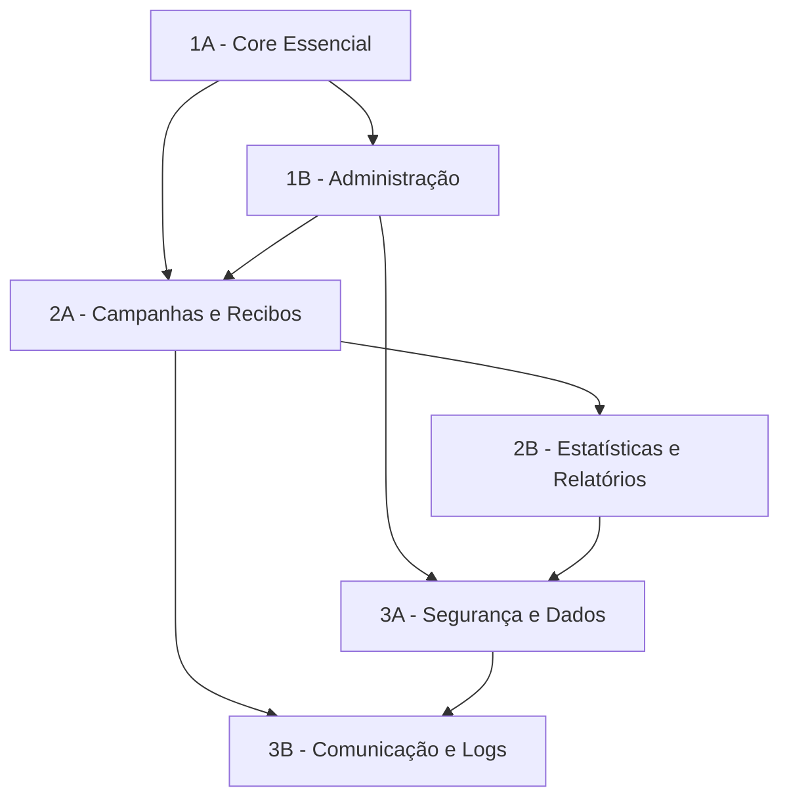

# 📚 Sistema de Gestão de Doações para Biblioteca

> Sistema completo para gestão de doações de livros com campanhas, relatórios e impacto social


---

## 🎯 **Visão Geral**

O **Sistema de Gestão de Doações** é uma solução enterprise completa para bibliotecas que desejam gerenciar doações de livros de forma eficiente, transparente e impactante. O sistema oferece desde o registro inicial das doações até relatórios executivos de impacto social.

### **🌟 Principais Funcionalidades**

- ✅ **Gestão completa de doadores** e histórico de doações
- ✅ **Catalogação inteligente** de livros com validação ISBN
- ✅ **Sistema de campanhas** com metas e acompanhamento
- ✅ **Geração automática** de recibos para doadores
- ✅ **Dashboard executivo** com métricas de impacto
- ✅ **Relatórios avançados** em PDF e Excel
- ✅ **Sistema de notificações** multi-canal
- ✅ **Segurança robusta** com JWT e auditoria completa

---

## 🏗️ **Arquitetura Modular**

O sistema foi arquitetado em **7 módulos independentes** para máxima flexibilidade, manutenibilidade e escalabilidade:



### **📋 Módulos do Sistema**

| **Módulo** | **Responsabilidade** | **Principais Classes** | **Uso Recomendado** |
|------------|---------------------|------------------------|---------------------|
| **1A - Core Essencial** | Entidades fundamentais | `Doador`, `Doacao`, `Livro`, `ItemDoacao` | Apresentações executivas |
| **1B - Administração** | Usuários e DTOs | `Administrador`, `Result`, `DadosDoacao` | Reuniões de desenvolvimento |
| **2A - Campanhas e Recibos** | Funcionalidades principais | `Campanha`, `Recibo`, `MetaTipo` | Reuniões de negócio |
| **2B - Estatísticas e Relatórios** | Analytics e dashboard | `PainelImpacto`, `EstatisticasGerais`, `RelatorioImpacto` | Análise funcional |
| **3A - Segurança e Dados** | Auth e persistência | `AuthenticationService`, `DatabaseConnection` | Implementação de segurança |
| **3B - Comunicação e Logs** | Integrações e logs | `EmailService`, `NotificationService`, `LoggingService` | Implementação de integrações |

---

## 🚀 **Início Rápido**

### **📋 Pré-requisitos**

- **Node.js** 18+ ou **Java** 11+
- **PostgreSQL** 13+
- **Redis** 6+ (opcional, para cache)
- **SMTP** configurado (para emails)

### **⚡ Instalação Rápida**

```bash
# Clone o repositório
git clone https://github.com/biblioteca/sistema-gestao-doacoes.git
cd sistema-gestao-doacoes

# Instale as dependências
npm install
# ou
mvn clean install

# Configure o banco de dados
cp .env.example .env
# Edite o arquivo .env com suas configurações

# Execute as migrações
npm run migrate
# ou
mvn flyway:migrate

# Inicie o servidor
npm start
# ou
mvn spring-boot:run
```

### **🌐 Acesso ao Sistema**

- **Interface Web:** http://localhost:3000
- **API REST:** http://localhost:3000/api
- **Documentação:** http://localhost:3000/docs
- **Monitoramento:** http://localhost:3000/health

---

## 📖 **Documentação Completa**

### **🎨 Diagramas UML por Contexto**

#### **📊 Para Diferentes Públicos**

| **Público** | **Módulos Recomendados** | **Tempo** | **Foco** |
|-------------|-------------------------|-----------|----------|
| **Executivos** | 1A | 5 min | Visão geral do negócio |
| **Product Owners** | 1A + 2A | 10 min | Funcionalidades principais |
| **Desenvolvedores** | 1A + 1B + 2A | 20 min | Entidades e operações |
| **Analistas** | 1A + 1B + 2A + 2B | 30 min | Funcionalidades completas |
| **DevOps/Security** | 1A + 1B + 3A | 40 min | Segurança e dados |
| **Arquitetos** | Todos os 7 módulos | 60 min | Arquitetura completa |

#### **📁 Localização dos Diagramas**

```
docs/
├── uml/
│   ├── modulo-1a-core-essencial.puml
│   ├── modulo-1b-administracao.puml
│   ├── modulo-2a-campanhas-recibos.puml
│   ├── modulo-2b-estatisticas-relatorios.puml
│   ├── modulo-3a-seguranca-dados.puml
│   └── modulo-3b-comunicacao-logs.puml
├── images/
│   ├── modulo-1a-core-essencial.png
│   ├── modulo-1b-administracao.png
│   ├── modulo-2a-campanhas-recibos.png
│   ├── modulo-2b-estatisticas-relatorios.png
│   ├── modulo-3a-seguranca-dados.png
│   └── modulo-3b-comunicacao-logs.png
└── README.md
```

---

## 🔧 **Detalhamento Técnico**

### **🔵 Módulo 1A: Core Essencial**

**Responsabilidades:**
- Gestão de doadores e seu histórico
- Processo principal de doações
- Catalogação de livros com validação
- Relacionamento entre doações e itens

**Principais Entidades:**
```typescript
class Doador {
  id: number;
  nomeCompleto: string;
  email: string;
  telefone: string;
  ativo: boolean;
}

class Doacao {
  id: number;
  doadorId: number;
  status: StatusDoacao;
  protocolo: string;
  valorEstimado: decimal;
}
```

**APIs Principais:**
- `POST /api/doadores` - Cadastro de doadores
- `POST /api/doacoes` - Registro de doações
- `GET /api/livros` - Consulta de livros
- `POST /api/itens-doacao` - Catalogação de itens

---

### **🔵 Módulo 1B: Administração**

**Responsabilidades:**
- Gestão de usuários administrativos
- DTOs para transferência de dados
- Padrões de retorno padronizados
- Filtros e configurações

**Principais Classes:**
```typescript
class Administrador {
  id: number;
  username: string;
  nome: string;
  email: string;
  ativo: boolean;
}

class Result<T> {
  success: boolean;
  message: string;
  data: T;
  errorCode?: string;
}
```

**APIs Principais:**
- `POST /api/auth/login` - Autenticação
- `POST /api/admin/usuarios` - Gestão de usuários
- `GET /api/admin/configuracoes` - Configurações do sistema

---

### **🟢 Módulo 2A: Campanhas e Recibos**

**Responsabilidades:**
- Sistema de campanhas com metas
- Geração automática de recibos
- Acompanhamento de progresso
- Configurações de campanha

**Principais Classes:**
```typescript
class Campanha {
  id: number;
  titulo: string;
  metaLivros: number;
  metaDoacoes: number;
  metaValor: decimal;
  ativa: boolean;
}

class Recibo {
  id: number;
  doacaoId: number;
  numeroRecibo: string;
  valorTotal: decimal;
}
```

**APIs Principais:**
- `POST /api/campanhas` - Criação de campanhas
- `GET /api/campanhas/ativas` - Campanhas ativas
- `POST /api/recibos/gerar` - Geração de recibos
- `GET /api/recibos/{numero}` - Consulta de recibos

---

### **🟢 Módulo 2B: Estatísticas e Relatórios**

**Responsabilidades:**
- Dashboard executivo centralizado
- Estatísticas consolidadas do sistema
- Relatórios em múltiplos formatos
- Gráficos e visualizações

**Principais Classes:**
```typescript
class PainelImpacto {
  static getInstance(): PainelImpacto;
  atualizarEstatisticas(): boolean;
  gerarRelatorioImpacto(): RelatorioImpacto;
}

class EstatisticasGerais {
  totalDoacoes: number;
  totalDoadores: number;
  totalLivros: number;
  valorTotalEstimado: decimal;
}
```

**APIs Principais:**
- `GET /api/dashboard/estatisticas` - Estatísticas gerais
- `GET /api/relatorios/impacto` - Relatório de impacto
- `POST /api/relatorios/gerar` - Geração de relatórios
- `GET /api/graficos/dados` - Dados para gráficos

---

### **🟡 Módulo 3A: Segurança e Dados**

**Responsabilidades:**
- Autenticação JWT com blacklist
- Pool de conexões com transações
- Cache Redis para performance
- Configurações de segurança

**Principais Classes:**
```typescript
class AuthenticationService {
  gerarToken(usuario: Administrador): string;
  validarToken(token: string): Result;
  invalidarToken(token: string): boolean;
}

class DatabaseConnection {
  executarQuery(sql: string, params: any[]): Result;
  iniciarTransacao(id: string): Transaction;
  commitTransacao(id: string): boolean;
}
```

**APIs Principais:**
- `POST /api/auth/token` - Geração de tokens
- `POST /api/auth/logout` - Invalidação de tokens
- `GET /api/auth/validate` - Validação de tokens
- `GET /api/database/health` - Status do banco

---

### **🟡 Módulo 3B: Comunicação e Logs**

**Responsabilidades:**
- Envio de emails e notificações
- Sistema de logs com rotação
- Gestão de arquivos e uploads
- Múltiplos canais de comunicação

**Principais Classes:**
```typescript
class EmailService {
  enviarRecibo(dadosRecibo: DadosRecibo): Result;
  enviarNotificacao(destinatario: string, assunto: string): Result;
}

class LoggingService {
  log(nivel: LogLevel, mensagem: string): void;
  obterLogs(filtros: FiltrosLog): LogEntry[];
}
```

**APIs Principais:**
- `POST /api/email/enviar` - Envio de emails
- `POST /api/notificacoes/enviar` - Notificações
- `POST /api/arquivos/upload` - Upload de arquivos
- `GET /api/logs` - Consulta de logs

---

## 🔐 **Segurança**

### **🛡️ Autenticação e Autorização**

- **JWT Tokens** com refresh automático
- **Blacklist de tokens** para logout seguro
- **Controle de acesso** baseado em roles
- **Auditoria completa** de operações

### **🔒 Proteção de Dados**

- **Criptografia** de senhas com bcrypt
- **Validação rigorosa** de inputs
- **Rate limiting** para APIs
- **HTTPS obrigatório** em produção

---

## 📊 **Monitoramento e Observabilidade**

### **📈 Métricas Principais**

- **Performance:** Tempo de resposta das APIs
- **Negócio:** Doações por período, valor arrecadado
- **Sistema:** CPU, memória, conexões de banco
- **Usuário:** Sessões ativas, operações por usuário

### **🔍 Logs e Rastreamento**

```typescript
// Exemplo de log estruturado
{
  "timestamp": "2025-08-15T10:30:00Z",
  "level": "INFO",
  "service": "doacao-service",
  "operation": "registrar-doacao",
  "userId": "admin123",
  "doadorId": "doador456",
  "message": "Doação registrada com sucesso",
  "duration": "150ms"
}
```

---

## 🚀 **Deployment**

### **🐳 Docker**

```yaml
# docker-compose.yml
version: '3.8'
services:
  app:
    build: .
    ports:
      - "3000:3000"
    environment:
      - DATABASE_URL=postgresql://user:pass@db:5432/doacoes
      - REDIS_URL=redis://redis:6379
    depends_on:
      - db
      - redis

  db:
    image: postgres:13
    environment:
      POSTGRES_DB: doacoes
      POSTGRES_USER: user
      POSTGRES_PASSWORD: pass

  redis:
    image: redis:6-alpine
```

### **☁️ Cloud Native**

- **Kubernetes** ready com health checks
- **Auto-scaling** baseado em métricas
- **Circuit breakers** para resilência
- **Blue-green deployment** para zero downtime

---

## 🧪 **Testes**

### **📋 Cobertura de Testes**

- **Unitários:** 95%+ cobertura
- **Integração:** APIs e banco de dados
- **E2E:** Fluxos principais de usuário
- **Performance:** Load testing com K6

```bash
# Executar testes
npm test                    # Testes unitários
npm run test:integration    # Testes de integração
npm run test:e2e           # Testes end-to-end
npm run test:performance   # Testes de performance
```

---

## 📈 **Roadmap**

### **🎯 Versão 1.1 (Q4 2025)**
- [ ] API GraphQL para consultas flexíveis
- [ ] Integração com redes sociais
- [ ] App mobile para doadores
- [ ] AI para categorização automática de livros

### **🎯 Versão 1.2 (Q1 2026)**
- [ ] Multi-tenancy para múltiplas bibliotecas
- [ ] Blockchain para transparência total
- [ ] Gamificação para engajamento
- [ ] Análise preditiva de doações

---

## 🤝 **Contribuindo**

### **📝 Guia de Contribuição**

1. **Fork** o repositório
2. **Crie** uma branch para sua feature (`git checkout -b feature/nova-funcionalidade`)
3. **Commit** suas mudanças (`git commit -am 'Adiciona nova funcionalidade'`)
4. **Push** para a branch (`git push origin feature/nova-funcionalidade`)
5. **Abra** um Pull Request

### **📏 Padrões de Código**

- **ESLint/Prettier** para formatação
- **Conventional Commits** para mensagens
- **TDD** para novas funcionalidades
- **Code Review** obrigatório

---

## 📞 **Suporte**

### **🆘 Canais de Suporte**

- **Documentation:** [docs.biblioteca.org](https://docs.biblioteca.org)
- **Issues:** [GitHub Issues](https://github.com/biblioteca/sistema-gestao-doacoes/issues)
- **Discussions:** [GitHub Discussions](https://github.com/biblioteca/sistema-gestao-doacoes/discussions)
- **Email:** suporte@biblioteca.org

### **🐛 Reportar Bugs**

Use o template de issue do GitHub incluindo:
- Versão do sistema
- Passos para reproduzir
- Comportamento esperado vs atual
- Screenshots (se aplicável)

---

## 📄 **Licença**

Este projeto está licenciado sob a **MIT License** - veja o arquivo [LICENSE](LICENSE) para detalhes.

---

## 🙏 **Agradecimentos**

• Biblioteca parceira da comunidade do Jangurussu pelos feedbacks e apoio
• À Profa. LIZIANE HOBMEIR e à UNINTER, pela orienta e oportunidade que tornam este projeto possível.
• Comunidade Open Source pelas contribuições
________________________________________

Este projeto tem como objetivo transformar bibliotecas comunitárias através de tecnologias da Ciência da Computação.
Se este projeto lhe ajudar e contribuir com a comunidade em que está disponível, por favor, considere dar uma estrela no GitHub e no YouTube!


---

<div align="center">

**⭐ Se este projeto te ajudou, considere dar uma estrela!**

[](https://github.com/biblioteca/sistema-gestao-doacoes)
[](https://github.com/biblioteca/sistema-gestao-doacoes/fork)

**🌟 Feito com ❤️ para transformar bibliotecas através da tecnologia**

</div>